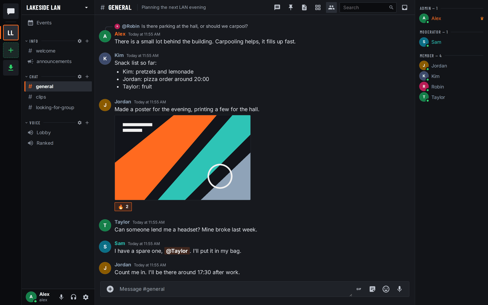
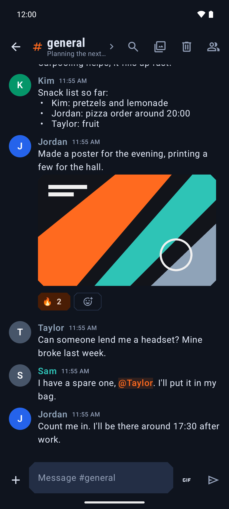

# Cillhub

Cillhub is a modern, high-performance, self-hostable community platform designed for real-time text, voice, and video communication. It gives communities, gaming clans, esports organizations, and teams full data sovereignty with zero tracking and seamless cross-platform clients.

Anyone can run a Cillhub server (a **node**) on their own infrastructure in minutes. Nodes can run in complete standalone isolation or link to the central Cillhub Network Hub at https://cillhub.cillerian.org for global directory discovery and single sign-on without ever exposing local server data or passwords.





---

## 🌟 Key Features

### 💬 Channels & Rich Communication
* **Text Channels**: Rich Markdown support, code syntax highlighting, inline file uploads, quote replies, spoiler tags, and granular `@mentions`.
* **Voice & Video Channels**: Low-latency multi-user voice and video channels powered by WebRTC with speaking indicators and individual volume controls.
* **Screen Sharing**: Crystal-clear 1080p 60 FPS application and screen sharing with system audio capture.
* **Stage Channels**: Moderated voice stages with designated speakers, a request-to-speak audience queue, and stage moderator controls.
* **Forum Channels**: Structured thread discussions with customizable tags, search, activity sorting, and pinned posts.
* **Announcement Channels**: Dedicated broadcast channels to publish news and announcements to all server members.
* **Discussion Threads**: Keep active sub-topics organized within text channels with automated inactivity archiving.
* **Direct Messages & Group DMs**: Private 1-on-1 chats, multi-user group conversations, and direct calling.

### ⚡ Interactive Community Tools
* **Interactive Polls**: Create single-choice or multi-choice polls with duration timers, live vote tallies, and real-time result bars.
* **Scheduled Events**: Plan tournaments, community game nights, or meetings with calendar RSVPs and automatic start notifications.
* **Custom Emojis & Stickers**: Upload server-specific static and animated emojis with custom shortcut codes and emoji search.
* **Message Reactions**: Fast emoji reactions and quick-reaction drawers.
* **Server Templates**: Export existing server channel and role structures or import ready-to-use community server templates.
* **Server Onboarding & Welcome Guide**: Greet newcomers with welcome screens, channel recommendations, and customizable rule acceptance gates.

### 🛡️ Moderation & Administration
* **Granular Role Hierarchy**: Unlimited custom roles with color pickers, hoisted member lists, mention permissions, and permission inheritance.
* **Channel Permission Overwrites**: Finely tuned channel-level access control, hidden staff channels, and role-based read/write rules.
* **AutoMod Rule Engine**: Real-time automated message filtering with custom regex patterns, keyword blocklists, mention spam protection, and automated action triggers (block, alert, or timeout).
* **Audit Logs**: Immutable administration action logs recording role modifications, channel updates, kicks, and bans with actor attribution.
* **Member Moderation**: One-click member timeout/mute, kick, and ban with configurable message history pruning.
* **High-Security Authentication**: Scrypt password hashing with 16-byte random salts, TOTP Two-Factor Authentication (2FA), and WebAuthn hardware key support.

### 🖥️ Native Desktop Experience (`desktop-rust`)
* **Ultra-Lightweight Footprint**: Engineered with Rust and Tauri 2, consuming ~70 MB of RAM (compared to 300+ MB on typical Electron clients).
* **Audio DSP & Noise Studio**: Built-in RNNoise neural network noise suppression, Acoustic Echo Cancellation (AEC), Auto Gain Control (AGC), and automatic game audio ducking.
* **Picture-in-Picture (PiP) Overlay**: Resizable, floating voice overlay showing active speakers, webcams, and screen shares on top of full-screen games.
* **Game Presence Detection**: Real-time game activity detection (including League of Legends LCU client status, Steam games, and active processes).
* **Native Windows Integration**: Windows Search indexing, App Paths, native Toast Notifications with quick actions, and zero permission prompts (auto-approved media access).

### 📱 Native Android Experience
* **Pure Jetpack Compose UI**: 100% Kotlin with Material 3 styling and dynamic Material You theme colors.
* **Native Telecom Calls**: Incoming voice and video calls ring through Android's native call screen just like standard phone calls.
* **Persistent Background Gateway**: Battery-efficient background service delivering instant push notifications without third-party tracking services.
* **Interactive Notifications**: Actionable notifications with direct quick-reply support.
* **In-App Self-Update**: OTA update checks with one-tap installation of signed releases.

### 🧩 Sandboxed Extensible Modules
* **WebAssembly QuickJS-ng Sandbox**: Custom server modules run in an isolated WebAssembly sandbox with zero host filesystem or raw network socket access.
* **Rich Interactions**: Register custom slash commands, interactive buttons, modal forms, select menus, and dashboard widgets.
* **Granular Capability Scopes**: Admins review and approve specific permission scopes (e.g. `messages.send`, `events.guild_member_add`) before modules run.
* **v9 REST & Gateway API**: Full compatibility with standard bot libraries and automation tooling.

### 🌐 Federated Linked Mode & Sovereignty
* **Standalone or Connected**: Operate as an isolated private server or link to the central **Cillhub Hub** (`https://cillhub.cillerian.org`) for unified identity and directory discovery.
* **Single Sign-On (SSO)**: Hub users can log into linked nodes with one click via Ed25519-signed OIDC tokens (zero password sharing).
* **Single-File Database**: Runs on a single Node.js process and one SQLite database file (`cillcord.sqlite`) — no Redis, no Postgres, and backups are a simple file copy.
* **Multilingual UI**: Native support for English and German.

---

## 📚 Documentation & Wiki

For detailed setup guides, tutorials, and architecture deep dives, visit our **[GitHub Wiki](https://github.com/Mrciller/Cillhub/wiki)**:
* 🚀 **[Self-Hosting Guide](https://github.com/Mrciller/Cillhub/wiki/Self-Hosting-Guide)** — Installing and running your own node with Docker Compose & Caddy.
* 🎙️ **[Voice & Media Setup](https://github.com/Mrciller/Cillhub/wiki/Voice-&-Media-Setup)** — Configuring the built-in `cillvoice` SFU vs. LiveKit and NAT traversal.
* 🔗 **[Federation & Linked Mode](https://github.com/Mrciller/Cillhub/wiki/Federation-&-Linked-Mode)** — Linking your node to the hub, identity exchange, and directory listing.
* 🖥️ **[Desktop App Setup](https://github.com/Mrciller/Cillhub/wiki/Desktop-App)** — Native Rust client features, audio DSP, and gaming presence.
* 📱 **[Android App Setup](https://github.com/Mrciller/Cillhub/wiki/Android-App)** — Building and configuring the native Android mobile app.
* 🧩 **[Module Development](https://github.com/Mrciller/Cillhub/wiki/Module-Development)** — Building custom server bots and UI extensions with the Module SDK.
* 🔧 **[Troubleshooting & FAQ](https://github.com/Mrciller/Cillhub/wiki/Troubleshooting-&-FAQ)** — Common questions, SSL issues, and maintenance.

---

## 🚀 Run your own server (Node)

You need a Linux machine with Docker (Compose v2), a domain pointing at it, ports 80/443 and one UDP port for voice.

```sh
# 1. the release key from this repository, the installer and its signed checksum list (https only)
curl -fsSL --proto '=https' -o release-public-key.pem https://raw.githubusercontent.com/Mrciller/Cillhub/main/selfhost/release-public-key.pem
for f in install.sh SHA256SUMS SHA256SUMS.sig; do curl -fsSLO --proto '=https' "https://cillhub.cillerian.org/download/server/$f"; done
# 2. run nothing unless the signature and the installer's checksum are good
openssl pkeyutl -verify -rawin -pubin -inkey release-public-key.pem -in SHA256SUMS -sigfile SHA256SUMS.sig \
  && sha256sum -c --ignore-missing SHA256SUMS \
  && sh install.sh       # asks for hostname, mode, voice backend, UDP port; --help lists all flags
```

The installer verifies every download against the Cillhub release key (signed by Pascal Oraze), starts the stack (server, updater, optional Caddy with Let's Encrypt and optional LiveKit) in `/opt/cillhub` and prints the address of the first-run wizard. There you create the admin account (2FA required), choose standalone or connected mode and automatic updates.

---

## 💻 Development Quickstart

Requirements: Node.js 24, npm. Optional: a LiveKit server for voice (or use `cillvoice`), Android SDK for the Android app, Rust for the native desktop client.

```sh
# server on a fresh temp data dir (voice is off without LiveKit or cillvoice settings)
cd server && npm ci && PORT=3300 DATA_DIR=$(mktemp -d) node src/index.js

# web client dev server against it
cd client && npm ci && VITE_API_BASE=http://localhost:3300 npm run dev

# production-like: build the client and let the server serve it
cd client && npm run build && cd ../server && PORT=3300 DATA_DIR=$(mktemp -d) STATIC_DIR=../client/dist node src/index.js
```

### Voice configuration
- **Built-in SFU (cillvoice)**: Add `VOICE_BACKEND=cillvoice CILLVOICE_UDP_PORT=50270 CILLVOICE_PUBLIC_IP=127.0.0.1`.
- **LiveKit**: Add `LIVEKIT_URL=http://127.0.0.1:7880 LIVEKIT_PUBLIC_URL=ws://127.0.0.1:7880 LIVEKIT_API_KEY=… LIVEKIT_API_SECRET=…` (keep keys in a local `.env`).

---

## ⚙️ Configuration Reference

| Environment Variable | Default | Description |
|---|---|---|
| `PORT` | `3000` | HTTP + WebSocket port (`0` = ephemeral) |
| `DATA_DIR` | `./data` | Directory for SQLite database, file uploads, media proxy cache, and security keys |
| `STATIC_DIR` | unset | Directory to serve static web client assets from |
| `LIVEKIT_URL` | unset | LiveKit HTTP API URL (e.g. `http://127.0.0.1:7880`) |
| `LIVEKIT_PUBLIC_URL` | unset | LiveKit WebSocket URL clients connect to (e.g. `ws://host/livekit`) |
| `LIVEKIT_API_KEY` | unset | LiveKit API key |
| `LIVEKIT_API_SECRET` | unset | LiveKit API secret |
| `VOICE_BACKEND` | `livekit` | Set to `cillvoice` to use the built-in media server |
| `CILLVOICE_UDP_PORT` | unset | UDP port for media traffic (ICE, DTLS, SRTP) |
| `CILLVOICE_PUBLIC_IP` | unset | Public IPv4 address for clients to send media to |
| `CILLCORD_HUB_URL` | unset | Origin of the network hub (`https://cillhub.cillerian.org`) for linked mode |
| `CILLCORD_PUBLIC_URL` | request origin | Public HTTPS origin of this node |
| `CILLCORD_SETUP_CODE` | unset | Setup code for first-run admin wizard (generated automatically by `install.sh`) |
| `TENOR_API_KEY` / `GIPHY_API_KEY` | unset | GIF search provider key; without one the picker only offers the built-in curated GIFs |
| `TRUST_PROXY` | unset | Reverse proxies whose `X-Forwarded-For` is believed (CIDR list; the compose file sets a default) |

---

## 🧪 Tests

```sh
# Server tests
cd server && npm test

# Web Client build & typecheck
cd client && npx tsc -b && npm run build

# Native Rust Desktop tests
cd desktop-rust && cargo test

# Electron Desktop tests
cd desktop && npm test

# Android Unit tests
cd android && ./gradlew testDebugUnitTest
```

---

## 📂 Project Layout

| Path | What |
|---|---|
| `server/` | Node 24, ES modules, plain JavaScript, `node:http`, `node:sqlite`, `ws`. REST, gateway, CDN, voice (LiveKit or cillvoice), hub/node federation, migrations, and test suites. |
| `client/` | Vite + React 19 + TypeScript, plain CSS, `livekit-client`. |
| `desktop-rust/` | Native Rust desktop client (Tauri 2, DSP audio engine, game tracking, lightweight memory footprint). |
| `desktop/` | Electron desktop client bundling the web application. |
| `android/` | Native Android app (Kotlin, Jetpack Compose): chat, servers, DMs, notifications, Android Auto, calls, self-update. |
| `selfhost/` | Node deployment package: `install.sh`, compose file, Caddyfile, updater sidecar, release tooling. |
| `scripts/` | End-to-end integration test suites and measurements. |
| `examples/modules/` | Example JavaScript modules (welcome roles, twitch sync, scrim boards, chess, etc.). |

---

## 📄 License

Copyright (C) 2026 Pascal Oraze

Cillhub is free software: you can redistribute it and/or modify it under the terms of the GNU Affero General Public License as published by the Free Software Foundation, version 3 (AGPL-3.0-only). It is distributed WITHOUT ANY WARRANTY. See [LICENSE](LICENSE) and [NOTICE](NOTICE).

If you run a modified version as a network service, the AGPL requires you to offer its source code to its users.
