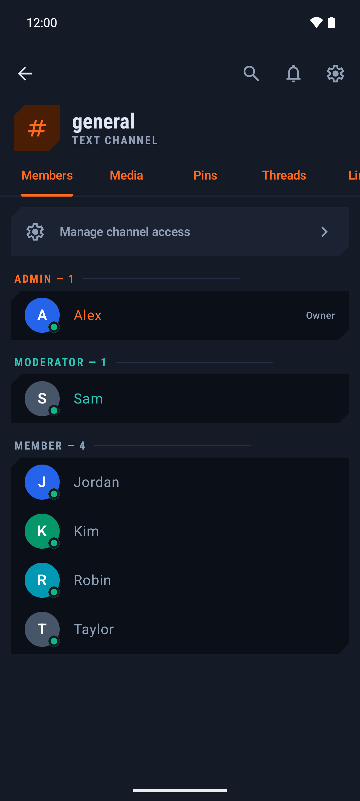
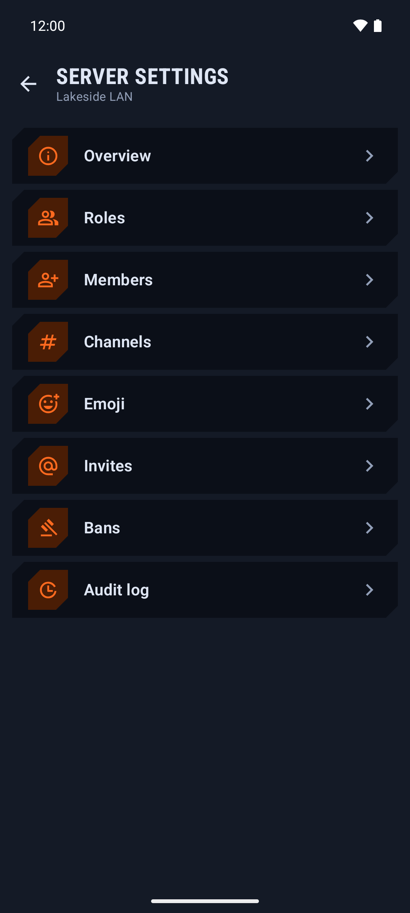

# Cillhub

Cillhub is a chat platform you can host yourself: servers with text channels, voice and video channels, direct messages, roles and moderation. One Node.js process and one SQLite file run a whole server. It has a web client, a desktop app for Windows and Linux, and a native Android app. A server can run on its own or link to the hub at https://cillhub.cillerian.org, so people can sign in with their hub account.


<p>
  
  
  
</p>

**Status:** early public test. Expect rough edges. Feedback is welcome, and bugs go to [GitHub issues](https://github.com/TCCiller/Cillhub/issues).

## Try it

- Open the hub in a browser: https://cillhub.cillerian.org
- Desktop and Android downloads: https://cillhub.cillerian.org/download/

## Features

### Chat
- Text, announcement and forum channels, threads, direct messages and group DMs
- Markdown, code blocks, spoilers, mentions, replies, reactions and pins
- File and image uploads, link previews, message search
- Custom emoji and stickers, a GIF picker with favourites
- Polls and scheduled events
- English and German interface

### Voice & video
- Voice and video channels, stage channels, calls in DMs
- Screen sharing; the Android app offers 720p or 1080p at up to 60 FPS
- Noise suppression and a noise gate in the web and desktop client
- Built-in media server (`cillvoice`) or an external LiveKit server

### Moderation & admin
- Roles with colours, hoisted member lists and per-channel permission overwrites
- Kick, ban with message removal, timeouts, nicknames
- AutoMod rules (keywords, regex, mention spam) and an audit log
- Server templates and an onboarding flow for new members
- Accounts: scrypt password hashes, TOTP two-factor, passkeys (WebAuthn)
- Server modules: JavaScript bots that run in a QuickJS WebAssembly sandbox with permissions an admin approves

### Self-hosting & federation
- One Docker Compose stack: server, updater sidecar, optional Caddy (Let's Encrypt) and optional LiveKit
- Data in one directory with one SQLite database (`cillcord.sqlite`)
- Standalone, or linked to the hub for sign-in with a hub account (Ed25519-signed ID tokens) and the server directory
- Optional automatic updates at a chosen hour

### Apps
- Web client, served by every Cillhub server
- Desktop (`desktop-rust`): Rust + Tauri 2 around the web client, packaged as Windows installer, AppImage and .deb; tray icon, `cillhub://` invite links, game activity, self-update checked against a pinned Ed25519 key
- Android (Kotlin, Jetpack Compose): the Cillhub palette by default, wallpaper colours as an option; calls through Android's Telecom service with answer and decline from the lock screen; notification quick reply; Android Auto; in-app updates from a signed feed

## Documentation

The [GitHub Wiki](https://github.com/TCCiller/Cillhub/wiki) has longer guides:

- [Self-Hosting Guide](https://github.com/TCCiller/Cillhub/wiki/Self-Hosting-Guide)
- [Voice & Media Setup](https://github.com/TCCiller/Cillhub/wiki/Voice-&-Media-Setup)
- [Federation & Linked Mode](https://github.com/TCCiller/Cillhub/wiki/Federation-&-Linked-Mode)
- [Desktop App](https://github.com/TCCiller/Cillhub/wiki/Desktop-App)
- [Android App](https://github.com/TCCiller/Cillhub/wiki/Android-App)
- [Module Development](https://github.com/TCCiller/Cillhub/wiki/Module-Development)
- [Troubleshooting & FAQ](https://github.com/TCCiller/Cillhub/wiki/Troubleshooting-&-FAQ)

## Run your own server

You need a Linux machine with Docker (Compose v2), a domain pointing at it, ports 80/443 and one UDP port for voice.

```sh
# 1. the release key from this repository, the installer and its signed checksum list (https only)
curl -fsSL --proto '=https' -o release-public-key.pem https://raw.githubusercontent.com/TCCiller/Cillhub/main/selfhost/release-public-key.pem
for f in install.sh SHA256SUMS SHA256SUMS.sig; do curl -fsSLO --proto '=https' "https://cillhub.cillerian.org/download/server/$f"; done
# 2. run nothing unless the signature and the installer's checksum are good
openssl pkeyutl -verify -rawin -pubin -inkey release-public-key.pem -in SHA256SUMS -sigfile SHA256SUMS.sig \
  && sha256sum -c --ignore-missing SHA256SUMS \
  && sh install.sh       # asks for hostname, mode, voice backend, UDP port; --help lists all flags
```

The installer checks every download against the Cillhub release key, starts the stack in `/opt/cillhub` and prints the address of the first-run wizard. There you create the admin account (2FA required), choose standalone or linked mode, and set automatic updates.

GIF search uses Tenor or Giphy when you set `TENOR_API_KEY` or `GIPHY_API_KEY`; without a key the GIF picker shows a small built-in catalog.

## Development

Requirements: Node.js 24 and npm. Optional: Rust for the desktop app, the Android SDK for the Android app, a LiveKit server if you do not use `cillvoice`.

```sh
# server on a fresh temp data dir (voice is off without LiveKit or cillvoice settings)
cd server && npm ci && PORT=3300 DATA_DIR=$(mktemp -d) node src/index.js

# web client dev server against it
cd client && npm ci && VITE_API_BASE=http://localhost:3300 npm run dev

# production-like: build the client and let the server serve it
cd client && npm run build && cd ../server && PORT=3300 DATA_DIR=$(mktemp -d) STATIC_DIR=../client/dist node src/index.js
```

Voice for local testing: add `VOICE_BACKEND=cillvoice CILLVOICE_UDP_PORT=50270 CILLVOICE_PUBLIC_IP=127.0.0.1` to the server command, or point it at LiveKit with `LIVEKIT_URL`, `LIVEKIT_PUBLIC_URL`, `LIVEKIT_API_KEY` and `LIVEKIT_API_SECRET`.

### Tests

```sh
cd server && npm test                                  # server unit and API tests
cd client && npm run build                             # typecheck and build
cd desktop-rust && cargo test && npm ci && npm run build   # Linux needs webkit2gtk-4.1, libayatana-appindicator3
cd android && ./gradlew testDebugUnitTest              # Android unit tests
NODE_PATH=<dir with playwright> npm run e2e:v8        # one of the browser suites in package.json; needs client/dist
android/scripts/emulator-test.sh                       # instrumented Android tests against throwaway servers
```

## Repository layout

| Path | What |
|---|---|
| `server/` | Node 24, plain JavaScript (ES modules), `node:http`, `node:sqlite`, `ws`: REST API, gateway, uploads, voice, federation, modules, tests |
| `client/` | Web client: Vite, React 19, TypeScript, plain CSS |
| `desktop-rust/` | Desktop app: Rust + Tauri 2 around the web client |
| `android/` | Android app: Kotlin, Jetpack Compose |
| `selfhost/` | `install.sh`, Compose file, Caddyfile, updater sidecar, release public key |
| `scripts/` | End-to-end test suites and measurements |
| `examples/modules/` | Example server modules (welcome roles, LFG finder, scrim board, tickets, trivia and more) |
| `docs/screenshots/` | The pictures in this README; `android/screenshots/` has more from the Android app |

## Security

Releases are signed with an Ed25519 key held by the maintainer; the public half is `selfhost/release-public-key.pem`. The server installer checks `SHA256SUMS` against that key, the updater sidecar checks the signed release feed and the SHA-256 of each image, the desktop app verifies each update against the pinned key before installing it, and the Android app checks the signature of its update feed and the SHA-256 of each APK.

To report a vulnerability, please [open a private security advisory on GitHub](https://github.com/TCCiller/Cillhub/security/advisories/new) instead of a public issue.

## License

Copyright (C) 2026 Pascal Oraze

Cillhub is free software under the GNU Affero General Public License, version 3 only (AGPL-3.0-only), without any warranty. See [LICENSE](LICENSE) and [NOTICE](NOTICE). If you run a modified version as a network service, the AGPL requires you to offer its source code to the users of that service.
